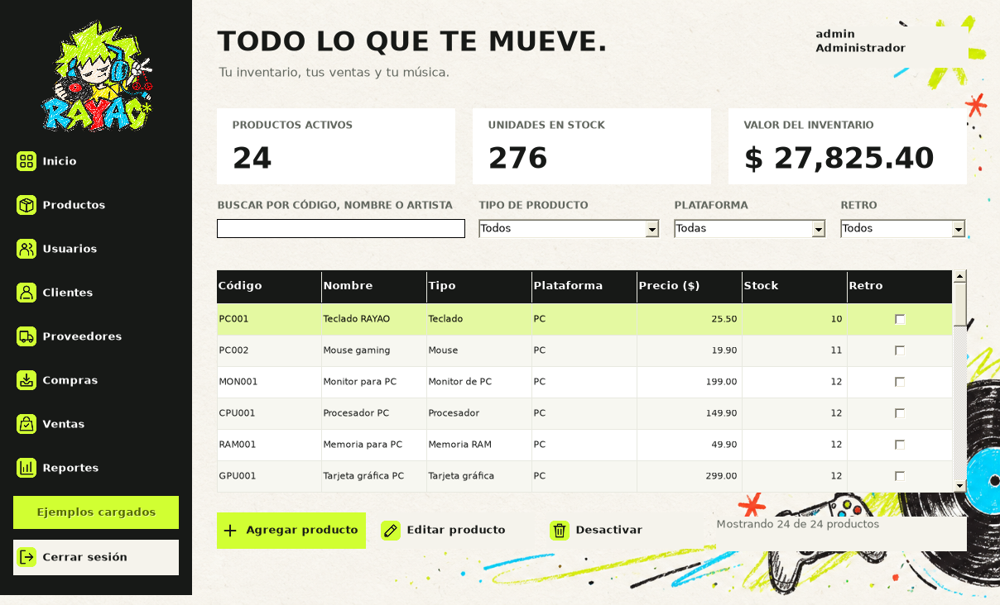
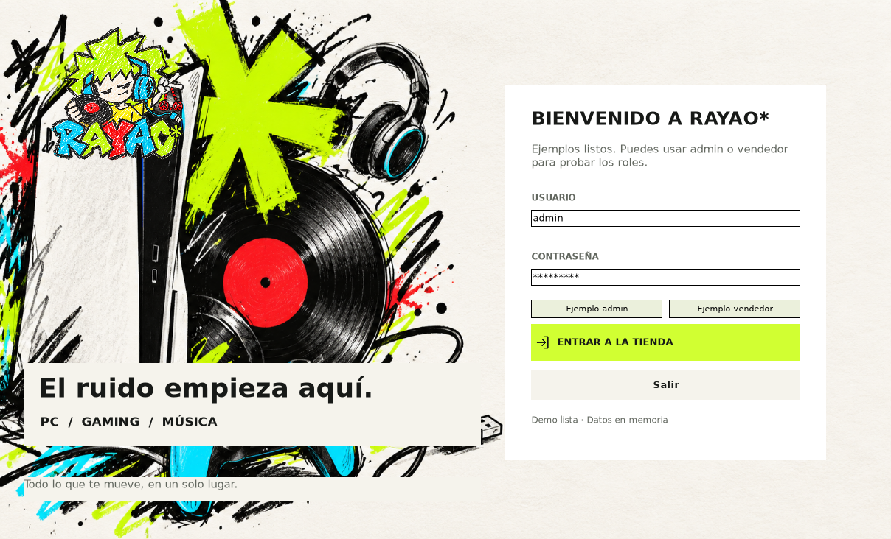
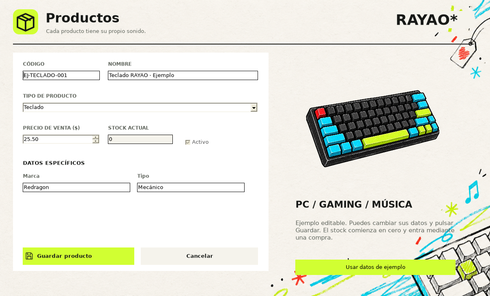
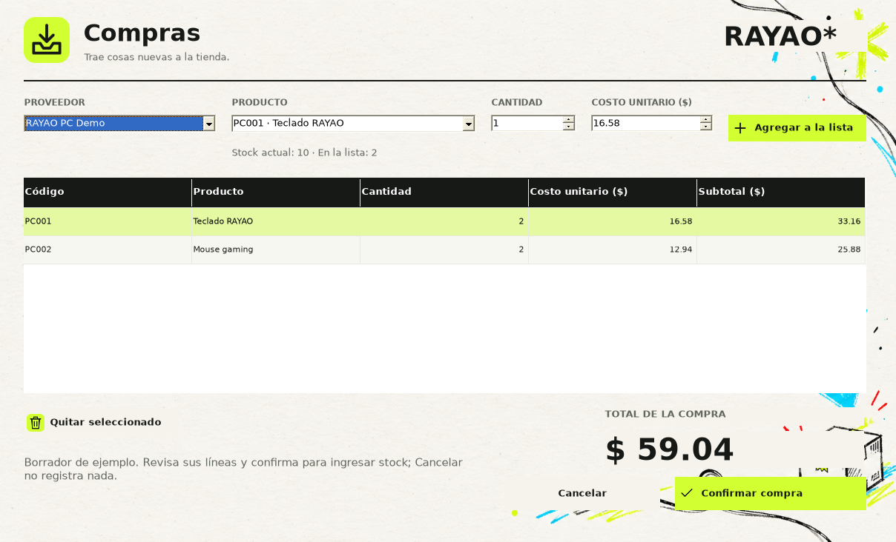
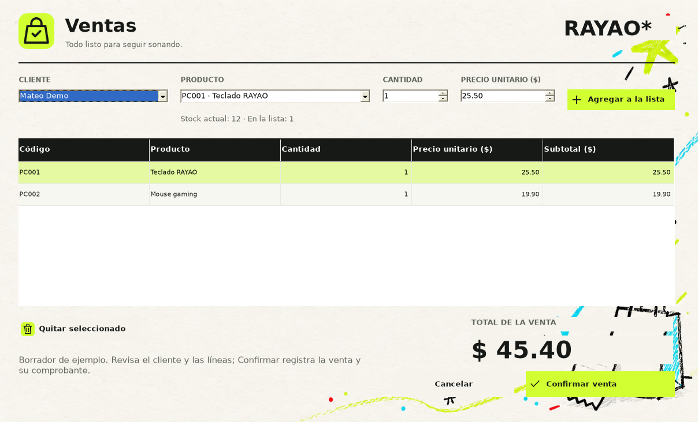
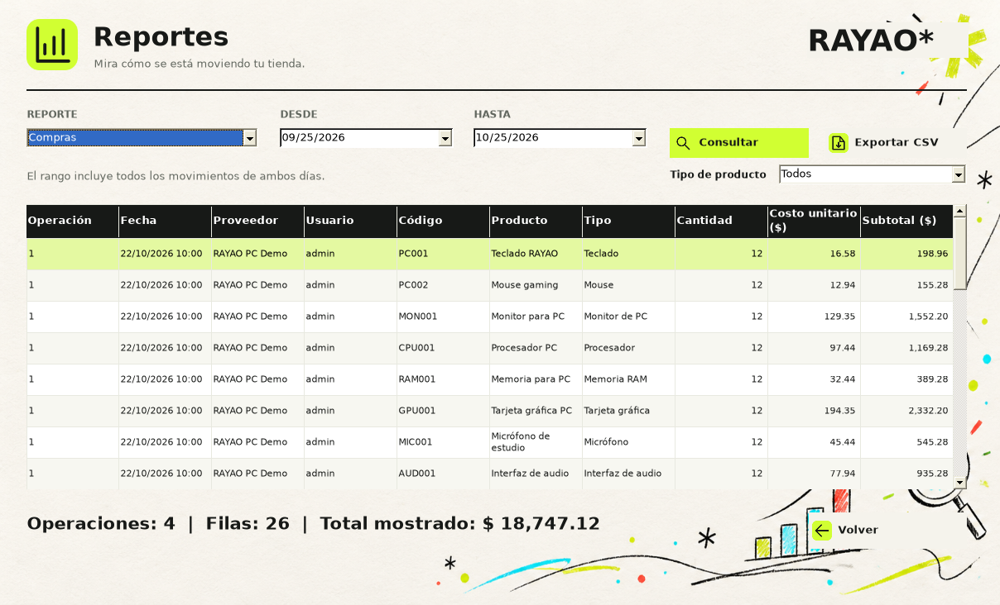
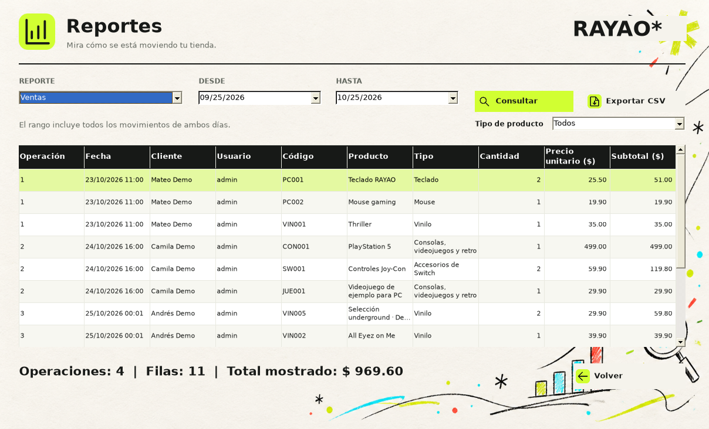

<p align="center">
  
</p>

<<<<<<< Updated upstream
Proyecto académico de Mateo Armijos. C#, Windows Forms y .NET Framework 4.7.2, con Entidades, Controladores y Formularios.
=======
<h3 align="center">Tu inventario, tus ventas y tu música.</h3>
>>>>>>> Stashed changes

<p align="center">
  
  
  
  
  <a href=".github/workflows/ci.yml"></a>
</p>

<<<<<<< Updated upstream
1. Abre la solución de la raíz: ProyectoParcialPA.slnx.
2. Establece ProyectoParcialPA como proyecto de inicio y ejecuta con F5.
3. Entra como administrador o vendedor.

| Rol | Usuario | Contraseña de demostración |
| --- | --- | --- |
| Administrador | admin | Admin123* |
| Vendedor | vendedor | Vendedor123* |

Las contraseñas se guardan como PBKDF2-HMAC-SHA256 con salt individual y 600000 iteraciones. Las cuentas de demostración se crean una sola vez por ejecución.

## Qué puedes hacer

- Gestionar los 12 tipos concretos de productos de PC, audio, vinilos y consolas.
- Buscar por código, nombre o artista y combinar tipo, plataforma y retro.
- Gestionar clientes, proveedores y usuarios con permisos por rol.
- Registrar compras y ventas con varios productos, validación de stock y confirmación única.
- Consultar el historial con sus datos originales, ver comprobantes e imprimirlos.
- Consultar reportes de inventario, compras y ventas y exportar CSV.

## Preparar la demostración

Como administrador, pulsa **Cargar ejemplo**. Se agregan 16 productos de muestra, un cliente y un proveedor; todos los productos comienzan con stock cero. Los nombres y precios son datos de demostración. El botón conserva los registros existentes y evita cargar el ejemplo dos veces.

Compra 5 unidades de PC001 a costo 18.00; después vende 2 a precio 25.50. La compra suma 90.00, la venta suma 51.00 y el stock queda en 3. El valor de inventario de ese producto será 76.50.

## Memoria y permisos

Los datos viven en listas estáticas en memoria. Cerrar sesión conserva la tienda; cerrar el programa pierde los datos. El vendedor consulta productos y proveedores, gestiona clientes, compra, vende y consulta reportes. El administrador gestiona todos los módulos.

## Compilación y pruebas

En Windows, scripts/Verificar.ps1 restaura, compila y ejecuta MSTest, y genera un TRX nuevo. La solución contiene el proyecto de pruebas separado net472.

La entrega incorpora 90 pruebas MSTest. En la preparación se ejecutaron sus aserciones mediante un runner por reflexión en Mono: 90 superadas, 0 fallidas. También se ejecutó un recorrido gráfico con 61 comprobaciones de interfaz. Documentacion/VALIDACION.md detalla el entorno y las comprobaciones pendientes de Windows.

GitHub Actions compila y ejecuta las pruebas en Windows. El resultado remoto solo queda confirmado después del push; consulta el job Build and test y el artefacto rayao-test-results.

## Organización

| Ruta | Contenido |
| --- | --- |
| ProyectoParcialPA/ProyectoParcialPA | Programa WinForms |
| ProyectoParcialPA/ProyectoParcialPA.Tests | Pruebas MSTest |
| Entidades, dentro del programa | Productos, usuarios, clientes, proveedores y movimientos |
| Controladores, dentro del programa | Listas, permisos y reglas de negocio |
| Formularios, dentro del programa | Nueve pantallas editables |
| Assets/png, dentro del programa | Fondos, productos, iconos y logo |
| Documentacion | Guía de demostración, validación y explicación para exponer |

La integración se entrega también por bloques para registrar cada avance en GitHub. El código y sus resultados se revisaron con apoyo de IA.
=======
<p align="center">
  <a href="#pantallas">Pantallas</a> ·
  <a href="#ejecutar">Ejecutar</a> ·
  <a href="#demo">Demo</a> ·
  <a href="#pruebas">Pruebas</a> ·
  <a href="#documentacion">Documentación</a>
</p>

**RAYAO*** es un sistema de escritorio para administrar una tienda de periféricos, componentes de PC, consolas y música. Reúne inventario, compras, ventas y reportes con una identidad inspirada en dibujos de crayón, vinilos y cultura gaming.

Proyecto académico de **Mateo Armijos y Kevin Aguilar**, carrera de Tecnologías de la Información, Universidad Técnica de Machala.

## Funciones

| Módulo | Qué puedes hacer |
| --- | --- |
| Inicio de sesión | Entrar como administrador o vendedor y cerrar sesión. |
| Panel principal | Consultar inventario, buscar productos y aplicar filtros. |
| Productos | Registrar y editar fichas con campos propios de cada tipo. |
| Clientes | Agregar, consultar, editar y desactivar registros. |
| Proveedores | Gestionar los proveedores que participan en las compras. |
| Usuarios | Administrar cuentas y permisos desde el rol administrador. |
| Compras | Preparar una compra y aumentar existencias al confirmarla. |
| Ventas | Validar stock, confirmar la venta y generar su comprobante. |
| Reportes | Consultar inventario e historial y exportar resultados en CSV. |

## Pantallas

### Panel principal



<details>
<summary><b>Ver login, productos, compras, ventas y reportes</b></summary>

<table>
  <tr>
    <th>Inicio de sesión</th>
    <th>Ficha de producto</th>
  </tr>
  <tr>
    <td></td>
    <td></td>
  </tr>
  <tr>
    <th>Compra</th>
    <th>Venta</th>
  </tr>
  <tr>
    <td></td>
    <td></td>
  </tr>
  <tr>
    <th>Reporte de compras</th>
    <th>Reporte de ventas</th>
  </tr>
  <tr>
    <td></td>
    <td></td>
  </tr>
</table>

</details>

*Capturas de la versión de demostración ejecutada en Mono. La apariencia de los controles puede variar en Windows.*

## Catálogo

El inventario admite **12 tipos concretos de producto**. Todos comparten código, nombre, precio y stock, y cada tipo añade sus propios datos.

| Familia | Tipos de producto |
| --- | --- |
| Periféricos de PC | Teclado, mouse y monitor. |
| Componentes de PC | Procesador, memoria RAM y tarjeta gráfica. |
| Equipos musicales | Micrófono e interfaz de audio. |
| Música | Vinilo con artista, género y año. |
| Periféricos de consola | Accesorios de PS5 y Nintendo Switch. |
| Gaming y retro | ProductoGaming para consolas, videojuegos y accesorios, con plataforma e indicador retro. |

## Ejecutar

Necesitas **Windows**, Visual Studio con las herramientas de desarrollo de escritorio de .NET, el **Developer Pack de .NET Framework 4.7.2** y las herramientas de .NET para ejecutar las pruebas. Usa una versión de Visual Studio compatible con la solución `.slnx`.

1. Clona o descarga el repositorio y abre **ProyectoParcialPA.slnx** desde la raíz.
2. Establece **ProyectoParcialPA** como proyecto de inicio. `ProyectoParcialPA.Tests` contiene las pruebas.
3. Restaura los paquetes NuGet y compila la solución.
4. Ejecuta con **F5** y espera el mensaje **Demo lista**.
5. Pulsa **Ejemplo admin** o **Ejemplo vendedor** y después **Entrar**.

Los recursos visuales se encuentran en `ProyectoParcialPA/ProyectoParcialPA/Assets`. El proyecto los copia al directorio de salida al compilar.

<details>
<summary><b>Cuentas de demostración</b></summary>

| Rol | Usuario | Contraseña inicial |
| --- | --- | --- |
| Administrador | `admin` | `Admin123*` |
| Vendedor | `vendedor` | `Vendedor123*` |
| Vendedor de caja | `caja_demo` | `Caja123*` |
| Administrador de ejemplo | `encargado_demo` | `Encargado123*` |

Son cuentas de la demostración con datos ficticios. Las contraseñas se almacenan con PBKDF2-HMAC-SHA256, salt individual y 600000 iteraciones.

</details>

## Demo

La carga inicial prepara **24 productos**, **6 clientes**, **4 proveedores**, **4 usuarios**, **3 compras** y **3 ventas**. Las compras ingresan 288 unidades y las ventas descuentan 12, dejando **276 unidades** en inventario.

Prueba este recorrido con una ejecución recién abierta y conserva los borradores de ejemplo:

| Paso | PC001 | PC002 | Importe de la operación |
| --- | ---: | ---: | ---: |
| Inventario inicial | 10 unidades | 11 unidades | — |
| Confirmar compra de 2 unidades de cada producto | 12 unidades | 13 unidades | $59.04 |
| Confirmar venta de 1 unidad de cada producto | 11 unidades | 12 unidades | $45.40 |

Después abre **Reportes** para consultar los movimientos y exportar un CSV. También puedes cancelar otra compra o venta para comprobar que el stock se conserva.

Los precios y contactos son ficticios. Los vinilos underground identificados como Demo son ejemplos del catálogo, sin ediciones comerciales verificadas.

> **Datos en memoria:** cerrar sesión conserva los registros. Cerrar el programa pierde las listas y una nueva ejecución vuelve a preparar los ejemplos.

## Permisos

| Acción | Administrador | Vendedor |
| --- | --- | --- |
| Consultar productos y stock | Sí | Sí |
| Crear, editar o desactivar productos | Sí | No |
| Gestionar clientes | Sí | Sí |
| Consultar proveedores | Sí | Sí |
| Gestionar proveedores | Sí | No |
| Registrar compras y ventas | Sí | Sí |
| Consultar reportes | Sí | Sí |
| Gestionar usuarios | Sí | No |

El vendedor abre la ficha de producto en modo consulta. Los controladores también comprueban los permisos de la sesión activa.

## Reglas de la tienda

- Cada producto tiene un código único. Un producto nuevo comienza con stock cero.
- Las cantidades son enteras positivas. Precios y costos deben ser mayores que cero y tener como máximo dos decimales.
- El stock cambia al confirmar la operación completa. Una cancelación o un error conserva el inventario y el historial.
- La venta se rechaza si las existencias no alcanzan. Las líneas repetidas se consideran al validar el total requerido.
- El costo de compra y el precio de venta son datos distintos. Los detalles históricos conservan los datos originales.
- Un producto con movimientos mantiene su tipo. El último administrador activo está protegido.

## Arquitectura

El proyecto sigue la metodología **Entidad, Controlador y Formulario**.

| Parte | Responsabilidad | Ruta |
| --- | --- | --- |
| Entidades | Representar productos, usuarios, clientes y operaciones. | [Entidades](ProyectoParcialPA/ProyectoParcialPA/Entidades) |
| Controladores | Aplicar validaciones y administrar las listas en memoria. | [Controladores](ProyectoParcialPA/ProyectoParcialPA/Controladores) |
| Formularios | Capturar datos y mostrar cada módulo de la tienda. | [Formularios](ProyectoParcialPA/ProyectoParcialPA/Formularios) |
| Pruebas | Comprobar reglas, permisos y movimientos del inventario. | [ProyectoParcialPA.Tests](ProyectoParcialPA/ProyectoParcialPA.Tests) |

`Producto` es abstracta. Sus clases derivadas permiten trabajar con una lista común y conservar campos específicos, como el socket de un procesador o el artista de un vinilo. Los nueve formularios conservan sus archivos `.cs`, `.Designer.cs` y `.resx`.

## Pruebas

La validación local de la etapa 7 registró **96 métodos de prueba superados** con las aserciones reales de MSTest mediante un runner por reflexión en Mono, y **68 comprobaciones de interfaz correctas**.

El [workflow de GitHub Actions](.github/workflows/ci.yml) está configurado para restaurar, compilar y ejecutar las pruebas en Windows. Comprueba el código de salida, la existencia del TRX y que se haya ejecutado al menos una prueba.

Para verificar el proyecto en tu equipo, ejecuta desde la raíz en Developer PowerShell de Visual Studio:

```powershell
.\scripts\Verificar.ps1
```

La ejecución de Visual Studio, VSTest/GitHub Actions, diseñador e impresión en Windows queda por confirmar en ese entorno. El alcance de las comprobaciones está en [VALIDACION.md](Documentacion/VALIDACION.md).

<a name="documentacion"></a>

## Documentación

| Archivo | Contenido |
| --- | --- |
| [Especificaciones](especificaciones.md) | Requisitos, reglas y comportamiento esperado. |
| [Plan técnico](plan-tecnico.md) | Estructura del proyecto y estado de las etapas. |
| [Guía de demostración](Documentacion/GUIA_DEMO.md) | Recorrido por pantallas, compras, ventas y roles. |
| [Guion de exposición](Documentacion/GUION_EXPOSICION.md) | Apoyo para presentar el proyecto. |
| [Validación](Documentacion/VALIDACION.md) | Resultados y límites de las pruebas realizadas. |
| [Créditos visuales](Documentacion/imagenes/readme/CREDITOS.md) | Recursos de la presentación del repositorio. |

## Próximos pasos

- Guardar y recuperar datos entre ejecuciones.
- Completar la validación en el entorno Windows de destino.
- Preparar una versión instalable con un proceso de publicación documentado.

---

<p align="center">
  <b>RAYAO*</b><br>
  Mateo Armijos · Kevin Aguilar<br>
  Programación Avanzada en C# · UTMACH
</p>
>>>>>>> Stashed changes
